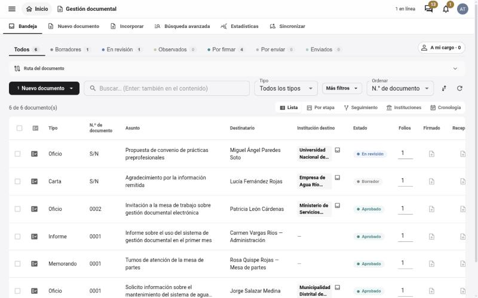
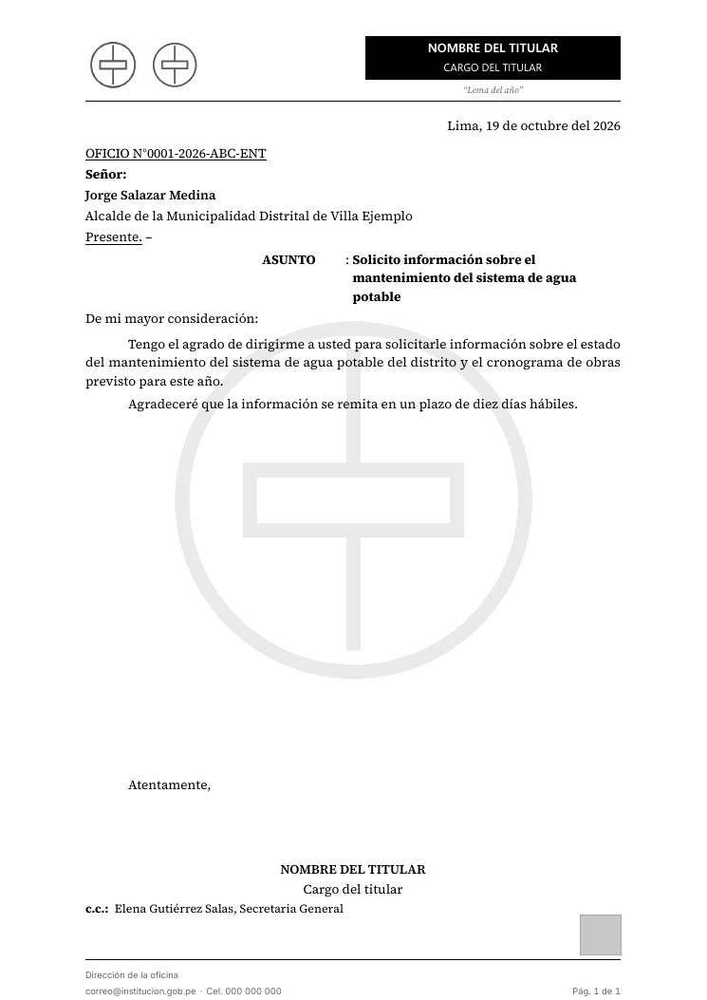
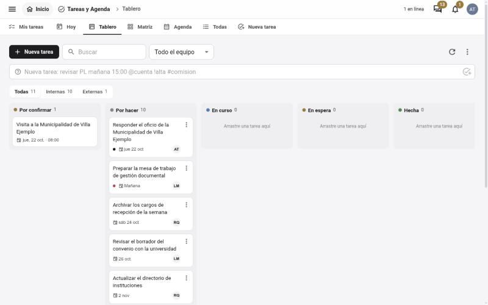
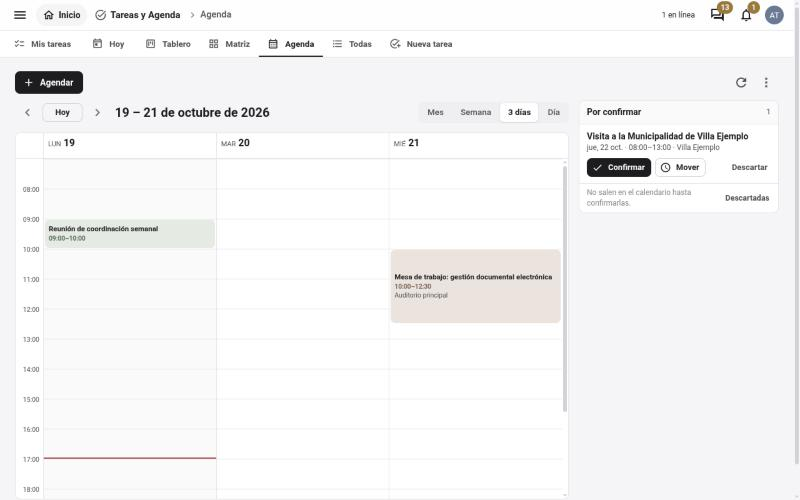
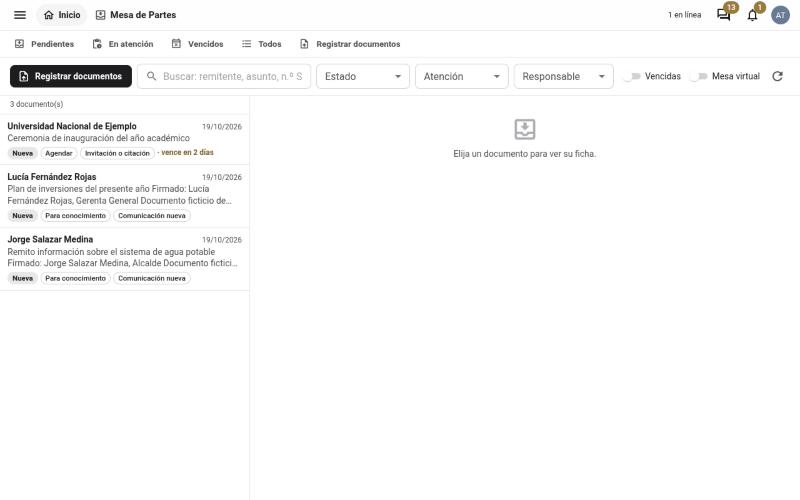

# Qillqa

**Gestión documental para entidades públicas y privadas.** Redacta, numera, revisa, firma, envía y archiva
documentos oficiales desde el navegador, con PDF de calidad tipográfica y sin tocar LaTeX.

*Qillqa* significa «escritura» en quechua.

**Recorrido interactivo:** <https://achalmed.github.io/qillqa/> (el código del sitio está en [`sitio/`](sitio/)).

[](LICENSE)


> Esta es la **versión de demostración**: trae todas las funciones y un juego de datos ficticio para
> probarlas. Ninguna persona, número ni documento de la demo es real.

## Qué resuelve

En muchas oficinas los documentos oficiales todavía se escriben en Word, se numeran a mano en un cuaderno
y se archivan en carpetas que nadie encuentra. Qillqa reúne ese ciclo en un solo lugar:

1. **Redactar** en un editor visual (como un procesador de textos), con plantillas por tipo de documento.
2. **Numerar** con un contador transaccional por serie y período: sin huecos ni números repetidos.
3. **Revisar** con observaciones, encargos y control de cambios.
4. **Generar** el PDF con el motor LuaLaTeX del marco documental (membrete, firma, pie y anexos).
5. **Enviar y seguir** el trámite: cargo de recepción, respuesta, plazos y estados.
6. **Archivar** con nombres de archivo uniformes y búsqueda en el contenido.

## Funciones

| módulo | qué hace |
|---|---|
| **Documentos** | bandeja con estados, nuevo documento por tipo (oficio, memorando, informe, carta, acta, comunicado…), incorporar documentos hechos fuera del sistema, versiones, búsqueda avanzada, estadísticas, visor rápido de PDF |
| **Mesa de partes** | registro de documentos recibidos (el sistema lee su ficha del PDF), responsable, plazo y respuesta; **mesa de partes virtual** pública con cargo en PDF |
| **Tareas y agenda** | mis tareas, tablero kanban, matriz urgente/importante, calendario por mes, semana y día |
| **Chat** | conversaciones directas y grupos del equipo, tarjetas de documentos, avisos |
| **Proyectos** | proyectos de largo aliento (por ejemplo, una norma o un reglamento) divididos en partes con fases, responsables y **edición simultánea** |
| **Informes de actividades** | semanas de trabajo de campo: actividades, pedidos, fotos y su informe en PDF |
| **Rendición de cuentas** | viáticos por comisión: comprobantes, declaración jurada, saldo y anexos |
| **Mediateca** | fotos y videos con revisión, favoritos y papelera |
| **Directorio** | instituciones, personas y **organigramas** navegables |
| **Mapa de relaciones** | cómo se citan y responden los documentos entre sí |
| **Sin conexión** | aplicación instalable (PWA): se sigue redactando cuando el servidor no responde |
| **Administración** | cuentas, roles, módulos activos, parámetros |

Integraciones opcionales (se apagan solas si no se configuran): OpenProject, Zotero, Calibre, Telegram.

## Capturas

Con los datos ficticios de la demo.

| Bandeja de documentos | PDF generado (membrete neutro) |
|---|---|
|  |  |
| **Tablero de tareas** | **Agenda** |
|  |  |
| **Mesa de partes** | **En el celular** |
|  |  |

## Probar la demo en cinco minutos

Requisitos: [Docker](https://docs.docker.com/get-docker/) con Docker Compose. La primera vez descarga la
imagen de TeX Live (varios GB): tómalo con calma.

```bash
git clone https://github.com/achalmed/qillqa.git
cd qillqa
cp .env.example .env            # cambia POSTGRES_PASSWORD y JWT_SECRET
docker compose up -d --build    # base de datos, API (con LuaLaTeX) y web
docker compose run --rm siembra # datos ficticios de demostración (idempotente)
```

Abre <http://localhost:5173> y entra con una de las cuentas de demostración:

| usuario | clave | cargo en la demo |
|---|---|---|
| `administrador` | `qillqa-demo` | administración |
| `ana.torres` | `qillqa-demo` | asesoría (redacta) |
| `luis.mamani` | `qillqa-demo` | coordinación (revisa) |
| `rosa.quispe` | `qillqa-demo` | secretaría (mesa de partes) |

La mesa de partes virtual pública queda en <http://localhost:5173/mesa-de-partes>.

Cambia estas claves antes de dejar la demo abierta a otras personas.

## Instalar para tu entidad

1. Copia `.env.example` a `.env` y completa: claves (`POSTGRES_PASSWORD`, `JWT_SECRET`,
   `SGDP_BOVEDA_CLAVE`), el nombre que muestra la web (`VITE_NOMBRE_DESPACHO`), las siglas, el período
   y el lugar de la numeración (`SIGLAS`, `PERIODO`, `LUGAR`). No uses `admin` como `ADMIN_USUARIO`.
2. Crea el **perfil** de tu entidad a partir de `perfil.ejemplo/`: datos del membrete, firma y sello.
   Apunta `MDD_PERFIL` a esa carpeta. Sin perfil, los PDF salen con un membrete neutro.
3. Reemplaza los emblemas de `marco_documental/assets/logos/` por los de tu entidad (mismo nombre de
   archivo).
4. `docker compose up -d --build`, entra como `administrador` y crea las cuentas del equipo en *Administración*.

Instalación sin Docker (servidor Linux con TeX Live): [`docs/desarrollo.md`](docs/desarrollo.md).

## Arquitectura

```
navegador ──► web (React + MUI + TipTap, Vite)  ──► API (FastAPI, Python 3.12) ──► PostgreSQL 16
                     │ edición simultánea (Yjs)          │
                     └──► servidor colab (Node)          └──► marco_documental/ (clases LuaLaTeX) ──► PDF
```

- `backend/` — API, modelos, servicios (numeración, compilación, nombres de archivo, mesa de partes…).
- `frontend/` — la web; `frontend/colab/` es el servidor de edición simultánea.
- `marco_documental/` — clases, estructuras y plantillas LuaLaTeX de los documentos.
- `perfil.ejemplo/` — modelo del perfil de una entidad.
- `docs/` — arquitectura, manual de uso, desarrollo y reglas de redacción.

Decisiones de fondo: [`docs/arquitectura.md`](docs/arquitectura.md).

## Colaborar

¡Las contribuciones son bienvenidas! Lee [`CONTRIBUTING.md`](CONTRIBUTING.md): cómo preparar el entorno,
las pruebas que deben pasar, el estilo de commits y **cómo escribir el README de cada carpeta**. Al
participar aceptas el [Código de conducta](CODE_OF_CONDUCT.md). Para reportar una vulnerabilidad, sigue
[`SECURITY.md`](SECURITY.md) y no abras un issue público.

## Citar

Si usas Qillqa en un trabajo académico o institucional, cítalo así (también en
[`CITATION.cff`](CITATION.cff); GitHub muestra el botón «Cite this repository»):

> Achalma, E. (2026). *Qillqa: gestión documental para entidades públicas y privadas* (versión 0.1.0-demo)
> [Software]. https://github.com/achalmed/qillqa

## Licencia

[GNU Affero General Public License v3.0](LICENSE). Puedes usar, estudiar, modificar y redistribuir Qillqa;
si lo ofreces como servicio por la red con cambios, debes publicar el código de esos cambios con la misma
licencia. Las fuentes tipográficas de `marco_documental/assets/fonts/` conservan su propia licencia (SIL Open
Font License).
